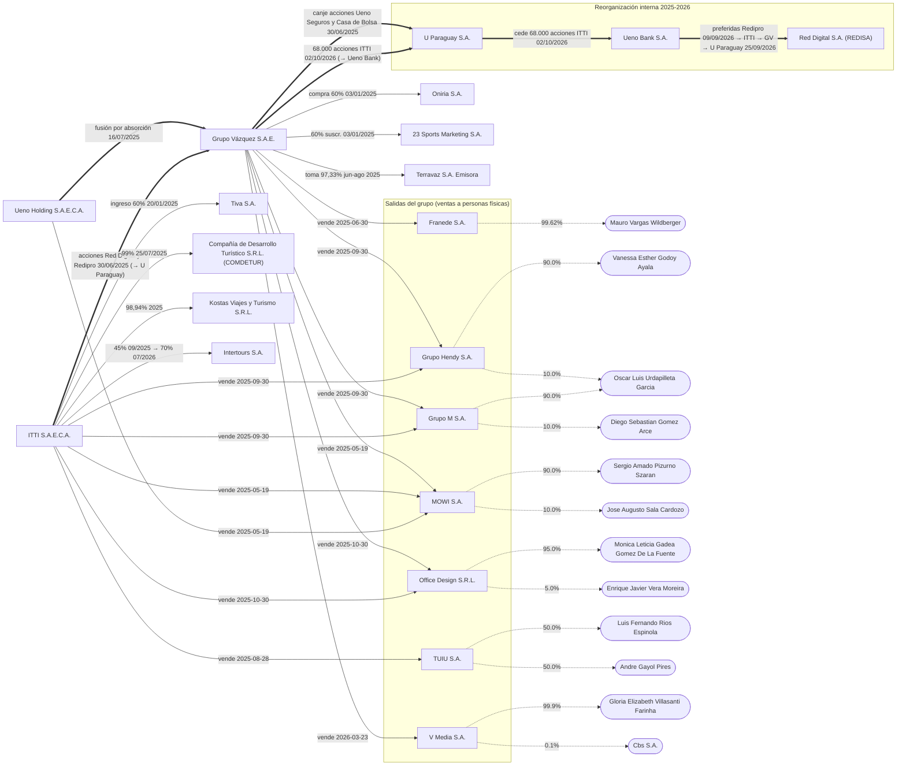

# Red societaria — entidades remitidas por el MEF (SIME 78.318/2026)

Generado automáticamente por `scripts/generar_informes.py` a partir de `datos/consolidado/`. Las cifras de participación integrada multiplican los porcentajes de capital a lo largo de todas las cadenas; el control se determina por mayoría de votos (directa o sumando sociedades bajo el mismo controlante). Fecha de corte "vigente" = dato más reciente marcado vigente en cada ficha (2025-2026). Ver `analisis/metodologia_datos.md`.

## Hallazgos principales

- **Controlante último declarado:** Federico Miguel Vázquez Villasanti (CI 2.941.546), titular de 75,94% del capital y ≈94% de los votos de Grupo Vázquez S.A.E., y declarado beneficiario final (condición E, cadena de titularidad) a través de U Holdings S.à r.l. (Luxemburgo, B280698) en el listado BF de Redipro. La composición societaria de U Holdings **no consta** en ningún documento: es el eslabón opaco de la cadena.
- **Cadena de control de Ueno Bank:** Ueno Bank S.A. ← U Paraguay S.A. (98.70% votos) ← UENO HOLDINGS S.A.R.L. (97.99% votos) ← Federico Miguel Vazquez Villasanti (declarado). Participación integrada en el capital: 91,21% vía U Holdings + 3,83% vía Grupo Vázquez (directo 1,96% + 2,01% de U Paraguay) = 95,04%. A marzo de 2024 el controlante directo era Grupo Vázquez (94,91% de los votos).
- **Dos ramas:** (1) financiera: U Holdings → U Paraguay → Ueno Bank, Ueno Seguros, Ueno Casa de Bolsa (→ Ueno AFPI), Red Digital y Redipro; (2) no financiera: Grupo Vázquez → ITTI (77,46% capital, ≈91% votos) → sociedades de tecnología, turismo, logística; GV directamente en Terravaz, Oniria y 23 Sports. Las ramas se cruzan: Ueno Bank tiene 16,95% de ITTI (02/10/2026) y GV conserva 2,01% de U Paraguay y 1,96% de Ueno Bank.
- **Reestructuración 2025-2026:** 7 sociedades salieron del grupo por venta a personas físicas (Franede, MOWI, TUIU, Grupo Hendy, Grupo M, Office Design, V Media); los compradores son en su mayoría directivos o allegados del propio grupo (Urdapilleta, Pizurno, Vera, Gadea, Villasanti, Mauro Vargas). En paralelo, el núcleo financiero se trasladó de Grupo Vázquez a U Paraguay/U Holdings (30/06/2025) y Ueno Holding S.A.E.C.A. fue absorbida por GV (16/07/2025).
- **Personas clave** (por número de entidades): Miguel Angel Almada Frutos (17), Cesar Manuel Astigarraga Lambare (15), Federico Miguel Vazquez Villasanti (13), Guillermo Vazquez Muniagurria (13), Bernardo Jose Algorta Rey (9), Luis Marcelo Cardozo Ledesma (8), Luis Ernesto Angulo Rivera (7), Liz Raquel Vazquez Benitez (7), Paola Analia Meza (6), Eduardo Javier Gross Brown Costa (6).
- **Domicilio común:** Torres del Paseo / Paseo La Galería (Avda. Santa Teresa 1827, Asunción); dominios de correo comunes gvcorp.com.py, uenoholding.com.py, itti.digital.

## (a) Organigrama de control vigente (participaciones ≥ 10% o control)

Flecha gruesa = controlante directo; punteada = control declarado en constancias BF sin porcentaje. Sólo entidades del grupo y sus titulares societarios.

```mermaid
flowchart TD
  subgraph persona["Controlante último (persona física)"]
    n_P0003["Federico Miguel Vazquez Villasanti"]
  end
  subgraph holding_controlante["Holding / controlantes"]
    n_grupo_vazquez["Grupo Vázquez S.A.E."]
    n_itti["ITTI S.A.E.C.A."]
    n_u_paraguay["U Paraguay S.A."]
    n_ueno_holdings_sarl["U Holdings S.à r.l. (Luxemburgo)"]
  end
  subgraph nucleo_financiero_ueno["Núcleo financiero Ueno"]
    n_redipro["Red Digital de Procesamiento S.A. (REDIPRO)"]
    n_redisa["Red Digital S.A. (REDISA)"]
    n_ueno_afpi["Ueno Administradora de Fondos Patrimoniales de Inversión S.A."]
    n_ueno_bank["Ueno Bank S.A."]
    n_ueno_casa_de_bolsa["Ueno Casa de Bolsa S.A."]
    n_ueno_seguros["Ueno Seguros S.A."]
  end
  subgraph controlada_itti_gv["Controladas por ITTI / Grupo Vázquez"]
    n_23_sports_marketing["23 Sports Marketing S.A."]
    n_comdetur["Compañía de Desarrollo Turístico S.R.L. (COMDETUR)"]
    n_discover_paraguay["Discover Paraguay S.A."]
    n_fintux["Fintux E.A.S."]
    n_hanoi["Hanoi S.A."]
    n_idl["Impresión Distribución y Logística S.A."]
    n_inter_express["Inter-Express S.A."]
    n_intertours["Intertours S.A."]
    n_kaitel["Kaitel S.R.L."]
    n_kostas_viajes["Kostas Viajes y Turismo S.R.L."]
    n_oniria["Oniria S.A."]
    n_place_analyzer["Place Analyzer E.A.S."]
    n_red_uts_paraguay["Red UTS Paraguay S.A."]
    n_terravaz["Terravaz S.A. Emisora"]
    n_tiva["Tiva S.A."]
    n_vinanzas["Vinanzas S.A."]
  end
  subgraph externa["Sociedades fuera del listado"]
    n_EXT_BALLOON["Balloon"]
    n_EXT_IOIO["Ioio"]
    n_EXT_MARKHEL["Markhel"]
    n_EXT_MATCH["Match"]
    n_EXT_WOM77["Wom77"]
  end
  n_grupo_vazquez ==>|"60,0%"| n_23_sports_marketing
  n_EXT_BALLOON -->|"10,0%"| n_23_sports_marketing
  n_itti ==>|"99,0%"| n_comdetur
  n_itti ==>|"74,8%"| n_discover_paraguay
  n_itti -->|"30,0% / 44,7% votos"| n_fintux
  n_P0003 ==>|"75,9% / 94,0% votos"| n_grupo_vazquez
  n_itti ==>|"72,8%"| n_hanoi
  n_EXT_MARKHEL -->|"27,2%"| n_hanoi
  n_itti ==>|"99,2%"| n_idl
  n_kostas_viajes ==>|"100,0%"| n_inter_express
  n_EXT_MATCH -->|"30,0%"| n_intertours
  n_itti ==>|"70,0%"| n_intertours
  n_grupo_vazquez ==>|"77,5% / 91,0% votos"| n_itti
  n_ueno_bank -->|"16,9% / 6,8% votos"| n_itti
  n_EXT_WOM77 ==>|"98,0%"| n_kaitel
  n_itti ==>|"98,9%"| n_kostas_viajes
  n_grupo_vazquez ==>|"60,0%"| n_oniria
  n_itti ==>|"60,0%"| n_place_analyzer
  n_u_paraguay ==>|"50,9% / 100,0% votos"| n_redipro
  n_ueno_bank -->|"49,1% / 0,0% votos"| n_redipro
  n_u_paraguay ==>|"27,9% / 100,0% votos"| n_redisa
  n_ueno_bank -->|"72,1% / 0,0% votos"| n_redisa
  n_itti -->|"40,2%"| n_red_uts_paraguay
  n_grupo_vazquez ==>|"97,3% / 98,4% votos"| n_terravaz
  n_itti ==>|"60,0%"| n_tiva
  n_P0003 -.->|"control declarado BF"| n_ueno_holdings_sarl
  n_ueno_holdings_sarl ==>|"98,0%"| n_u_paraguay
  n_ueno_casa_de_bolsa ==>|"100,0%"| n_ueno_afpi
  n_u_paraguay ==>|"93,1% / 98,7% votos"| n_ueno_bank
  n_u_paraguay ==>|"100,0%"| n_ueno_casa_de_bolsa
  n_u_paraguay ==>|"82,0% / 90,6% votos"| n_ueno_seguros
  n_itti ==>|"49,7%"| n_vinanzas
  n_EXT_IOIO -->|"37,9%"| n_vinanzas
  n_grupo_vazquez -->|"12,3%"| n_vinanzas
  n_itti -.->|"control declarado BF"| n_EXT_WOM77
  classDef persona fill:#fde68a,stroke:#92400e;
  class n_P0003 persona;
```

## (b) Salidas y transferencias 2025-2026

Salidas del grupo (venta de la totalidad de la participación de GV/ITTI) y principales reorganizaciones/entradas documentadas en los historiales.

### Salidas del grupo (tabla)

| Entidad | Fecha | Vendedores | Titulares actuales |
|---|---|---|---|
| Franede S.A. | 2025-06-30 | Grupo Vázquez S.A.E. | Mauro Vargas Wildberger (99.62%) |
| Grupo Hendy S.A. | 2025-09-30 | Grupo Vázquez S.A.E.; ITTI S.A.E.C.A. | Vanessa Esther Godoy Ayala (90.0%); Oscar Luis Urdapilleta Garcia (10.0%) |
| Grupo M S.A. | 2025-09-30 | Grupo Vázquez S.A.E.; ITTI S.A.E.C.A. | Oscar Luis Urdapilleta Garcia (90.0%); Diego Sebastian Gomez Arce (10.0%) |
| MOWI S.A. | 2025-05-19 | Grupo Vázquez S.A.E.; ITTI S.A.E.C.A.; Ueno Holding S.A.E.C.A. | Sergio Amado Pizurno Szaran (90.0%); Jose Augusto Sala Cardozo (10.0%) |
| Office Design S.R.L. | 2025-10-30 | Grupo Vázquez S.A.E.; ITTI S.A.E.C.A. | Monica Leticia Gadea Gomez De La Fuente (95.0%); Enrique Javier Vera Moreira (5.0%) |
| TUIU S.A. | 2025-08-28 | ITTI S.A.E.C.A. | Luis Fernando Rios Espinola (50.0%); Andre Gayol Pires (50.0%) |
| V Media S.A. | 2026-03-23 | Grupo Vázquez S.A.E. | Gloria Elizabeth Villasanti Farinha (99.9%); CBS S.A. (0.1%) |

## Control por entidad: vigente vs. 2024

UH = participación integrada desde U Holdings; GV = desde Grupo Vázquez; Grupo = UH + GV + tenencia directa de F. M. Vázquez. La situación 2024 combina la foto ≤ 31/12/2024 y una reconstrucción documentada (ver `control_indirecto.csv`, columna notas).

| Entidad | Segmento | Controlante directo vigente | Controlante último | % UH | % GV | % Grupo | Controlante directo 2024 |
|---|---|---|---|---|---|---|---|
| 23 Sports Marketing S.A. | Controladas por ITTI / Grupo Vázquez | Grupo Vázquez S.A.E. (60,00% v.) | Federico Miguel Vazquez Villasanti | — | 60,00 | 60,00 | s/d |
| AIME S.A. Corredores de Seguros | Participadas minoritarias / vínculo indirecto | Martin Vargas Wildberger (95,65% v.) | Martin Vargas Wildberger | — | — | — | s/d |
| CBS S.A. | Participadas minoritarias / vínculo indirecto | Chaco I Trader (90,00% v.) | Chaco I Trader | — | — | — | s/d |
| Compañía de Desarrollo Turístico S.R.L. (COMDETUR) | Controladas por ITTI / Grupo Vázquez | ITTI S.A.E.C.A. (99,00% v.) | Federico Miguel Vazquez Villasanti | 17,85 | 78,12 | 95,97 | s/d |
| Discover Paraguay S.A. | Controladas por ITTI / Grupo Vázquez | ITTI S.A.E.C.A. (74,79% v.) | Federico Miguel Vazquez Villasanti | 13,38 | 58,58 | 72,37 | ITTI S.A.E.C.A. (74,79% v.) |
| Franede S.A. | Ex vinculadas (salidas 2025-2026) | Mauro Vargas Wildberger (100,00% v.) | Mauro Vargas Wildberger | — | — | — | Grupo Vázquez S.A.E. (99,62% v.) |
| Galadriel S.A. | Sin vínculo detectado | Antonio Ignacio Villa Berkemeyer (90,00% v.) | Antonio Ignacio Villa Berkemeyer | — | — | — | s/d |
| Grupo Berilo S.A. | Sin vínculo detectado | 13 De Agosto (51,00% v.) | 13 De Agosto | — | — | — | s/d |
| Grupo Hendy S.A. | Ex vinculadas (salidas 2025-2026) | Vanessa Esther Godoy Ayala (90,00% v.) | Vanessa Esther Godoy Ayala | — | — | — | ITTI S.A.E.C.A. (99,04% v.) |
| Grupo M S.A. | Ex vinculadas (salidas 2025-2026) | Oscar Luis Urdapilleta Garcia (90,00% v.) | Oscar Luis Urdapilleta Garcia | — | — | — | ITTI S.A.E.C.A. (99,02% v.) |
| Grupo Vázquez S.A.E. | Holding / controlantes | Federico Miguel Vazquez Villasanti (94,02% v.) | Federico Miguel Vazquez Villasanti | — | — | 100,00 | Federico Miguel Vazquez Villasanti |
| Hanoi S.A. | Controladas por ITTI / Grupo Vázquez | ITTI S.A.E.C.A. (72,76% v.) | Federico Miguel Vazquez Villasanti | 13,02 | 56,99 | 70,01 | ITTI S.A.E.C.A. (72,76% v.) |
| HD Invest E.A.S. Unipersonal | Sin vínculo detectado | Karim Hamza Damani Chaparro (100,00% v.) | Karim Hamza Damani Chaparro | — | — | — | Karim Hamza Damani Chaparro (100,00% v.) |
| Impresión Distribución y Logística S.A. | Controladas por ITTI / Grupo Vázquez | ITTI S.A.E.C.A. (99,23% v.) | Federico Miguel Vazquez Villasanti | 17,76 | 78,49 | 96,25 | ITTI S.A.E.C.A. (99,23% v.) |
| Inter-Express S.A. | Controladas por ITTI / Grupo Vázquez | Kostas Viajes y Turismo S.R.L. (99,98% v.) | Federico Miguel Vazquez Villasanti | 17,85 | 78,11 | 95,96 | s/d |
| Intertours S.A. | Controladas por ITTI / Grupo Vázquez | ITTI S.A.E.C.A. (70,00% v.) | Federico Miguel Vazquez Villasanti | 12,53 | 54,82 | 67,35 | Miguel Angel Martin Del Castillo (75,00% v.) |
| ITTI S.A.E.C.A. | Holding / controlantes | Grupo Vázquez S.A.E. (90,97% v.) | Federico Miguel Vazquez Villasanti | 17,90 | 78,32 | 96,22 | Grupo Vázquez S.A.E. (94,40% v.) |
| Kaitel S.R.L. | Controladas por ITTI / Grupo Vázquez | Wom77 (98,00% v.) | Federico Miguel Vazquez Villasanti | 0,35 | 1,57 | 1,93 | s/d |
| Kostas Viajes y Turismo S.R.L. | Controladas por ITTI / Grupo Vázquez | ITTI S.A.E.C.A. (98,94% v.) | Federico Miguel Vazquez Villasanti | 17,85 | 78,11 | 95,96 | s/d |
| La Tropa Fletes E.A.S. | Sin vínculo detectado | Carlos Damian Gauto Paredes (65,00% v.) | Carlos Damian Gauto Paredes | — | — | — | Carlos Damian Gauto Paredes (65,00% v.) |
| MOWI S.A. | Ex vinculadas (salidas 2025-2026) | Sergio Amado Pizurno Szaran (90,00% v.) | Sergio Amado Pizurno Szaran | — | — | — | ITTI S.A.E.C.A. (100,00% v.) |
| Nubicom Paraguay S.A. | Participadas minoritarias / vínculo indirecto | Nubicom (99,32% v.) | Nubicom | — | — | — | s/d |
| Office Design S.R.L. | Ex vinculadas (salidas 2025-2026) | Monica Leticia Gadea Gomez De La Fuente (95,00% v.) | Monica Leticia Gadea Gomez De La Fuente | — | — | — | Grupo Vázquez S.A.E. |
| Oniria S.A. | Controladas por ITTI / Grupo Vázquez | Grupo Vázquez S.A.E. (60,00% v.) | Federico Miguel Vazquez Villasanti | — | 60,00 | 60,00 | Camilo Jose Guanes Mersan (75,00% v.) |
| Place Analyzer E.A.S. | Controladas por ITTI / Grupo Vázquez | ITTI S.A.E.C.A. (60,00% v.) | Federico Miguel Vazquez Villasanti | 10,74 | 46,99 | 57,73 | ITTI S.A.E.C.A. (60,00% v.) |
| Red Digital de Procesamiento S.A. (REDIPRO) | Núcleo financiero Ueno | U Paraguay S.A. (100,00% v.) | Federico Miguel Vazquez Villasanti | 94,67 | 2,90 | 97,57 | ITTI S.A.E.C.A. |
| Red Digital S.A. (REDISA) | Núcleo financiero Ueno | U Paraguay S.A. (99,99% v.) | Federico Miguel Vazquez Villasanti | 93,10 | 3,32 | 96,42 | ITTI S.A.E.C.A. (99,99% v.) |
| Technoma S.A.E.C.A. | Participadas minoritarias / vínculo indirecto | Enrique Javier Vera Moreira (51,83% v.) | Enrique Javier Vera Moreira | — | — | — | s/d |
| Terravaz S.A. Emisora | Controladas por ITTI / Grupo Vázquez | Grupo Vázquez S.A.E. (98,36% v.) | Federico Miguel Vazquez Villasanti | — | 97,33 | 97,33 | s/d |
| Tiva S.A. | Controladas por ITTI / Grupo Vázquez | ITTI S.A.E.C.A. (60,00% v.) | Federico Miguel Vazquez Villasanti | 10,74 | 46,99 | 57,73 | ITTI S.A.E.C.A. (60,00% v.) |
| TUIU S.A. | Ex vinculadas (salidas 2025-2026) | Luis Fernando Rios Espinola (83,33% v.) | Luis Fernando Rios Espinola | — | — | — | s/d |
| UENO HOLDINGS S.A.R.L. | Holding / controlantes | Federico Miguel Vazquez Villasanti | Federico Miguel Vazquez Villasanti | — | — | 100,00 | Federico Miguel Vazquez Villasanti |
| U Paraguay S.A. | Holding / controlantes | UENO HOLDINGS S.A.R.L. (97,99% v.) | Federico Miguel Vazquez Villasanti | 97,99 | 2,01 | 100,00 | UENO HOLDINGS S.A.R.L. (99,99% v.) |
| Ueno Administradora de Fondos Patrimoniales de Inversión S.A. | Núcleo financiero Ueno | Ueno Casa de Bolsa S.A. (99,97% v.) | Federico Miguel Vazquez Villasanti | 97,96 | 2,04 | 100,00 | Ueno Casa de Bolsa S.A. (90,00% v.) |
| Ueno Bank S.A. | Núcleo financiero Ueno | U Paraguay S.A. (98,70% v.) | Federico Miguel Vazquez Villasanti | 91,21 | 3,83 | 95,04 | Grupo Vázquez S.A.E. (94,91% v.) |
| Ueno Casa de Bolsa S.A. | Núcleo financiero Ueno | U Paraguay S.A. (99,99% v.) | Federico Miguel Vazquez Villasanti | 97,98 | 2,02 | 100,00 | Grupo Vázquez S.A.E. (88,60% v.) |
| Ueno Seguros S.A. | Núcleo financiero Ueno | U Paraguay S.A. (90,58% v.) | Federico Miguel Vazquez Villasanti | 80,40 | 7,04 | 87,43 | Grupo Vázquez S.A.E. |
| V Media S.A. | Ex vinculadas (salidas 2025-2026) | Gloria Elizabeth Villasanti Farinha (99,90% v.) | Gloria Elizabeth Villasanti Farinha | — | — | — | Grupo Vázquez S.A.E. (99,90% v.) |
| Villa Oliva Rice S.A. | Sin vínculo detectado | Camilatam (99,95% v.) | Camilatam | — | — | — | s/d |
| Vinanzas S.A. | Controladas por ITTI / Grupo Vázquez | ITTI S.A.E.C.A. (62,07% v.) | Federico Miguel Vazquez Villasanti | 8,90 | 51,29 | 60,19 | s/d |

## Personas recurrentes (top 30 por número de entidades)

| ID | Persona | CI | Nº entidades | Roles por entidad |
|---|---|---|---|---|
| P0001 | Miguel Angel Almada Frutos | 1202532 | 17 | 23 Sports Marketing S.A.: BF; AIME S.A. Corredores de Seguros: Director suplente; Discover Paraguay S.A.: Síndico titular; Inter-Express S.A.: Síndico titular; Intertours S.A.: Síndico titular; Kaitel S.R.L.: Gerente; Nubicom Paraguay S.A.: Secretario de asamblea; Red Digital de Procesamiento S.A. (REDIPRO): BF; Red Digital S.A. (REDISA): Síndico titular; Terravaz S.A. Emisora: Síndico titular; TUIU S.A.: Síndico titular; U Paraguay S.A.: Síndico titular; Ueno Bank S.A.: Síndico titular; UENO HOLDINGS S.A.R.L.: Representante del accionista U Holdings ; Ueno Seguros S.A.: Síndico suplente, Sínd |
| P0002 | Cesar Manuel Astigarraga Lambare | 3807117 | 15 | 23 Sports Marketing S.A.: BF; Hanoi S.A.: Presidente; Impresión Distribución y Logística S.A.: Director Vicepresidente, Presidente; Inter-Express S.A.: Presidente; Intertours S.A.: Representante legal de ITTI S.A.E.; ITTI S.A.E.C.A.: Presidente; Place Analyzer E.A.S.: Director titular; Red UTS Paraguay S.A.: Presidente; Red Digital S.A. (REDISA): Presidente; Terravaz S.A. Emisora: Síndico suplente; Tiva S.A.: Presidente / Representante legal; TUIU S.A.: Presidente; Ueno Bank S.A.: Síndico suplente; Ueno Seguros S.A.: Síndico suplente; V Media S.A.: Director titular |
| P0003 | Federico Miguel Vazquez Villasanti | 2941546 | 13 | 23 Sports Marketing S.A.: BF; Discover Paraguay S.A.: accionista; Grupo Vázquez S.A.E.: Presidente, accionista; Kaitel S.R.L.: BF; MOWI S.A.: Vicepresidente, accionista; Place Analyzer E.A.S.: BF; Red UTS Paraguay S.A.: BF; Red Digital de Procesamiento S.A. (REDIPRO): BF; Red Digital S.A. (REDISA): BF; Tiva S.A.: BF; U Paraguay S.A.: Vicepresidente, accionista; Ueno Bank S.A.: Vicepresidente 1°; UENO HOLDINGS S.A.R.L.: Representante de U Holdings en la Asambl |
| P0004 | Guillermo Vazquez Muniagurria | 3799529 | 13 | 23 Sports Marketing S.A.: BF; Compañía de Desarrollo Turístico S.R.L. (COMDETUR): Gerente, Representante legal; Franede S.A.: Presidente de Asamblea designado; Grupo Vázquez S.A.E.: Director, Vicepresidente, accionista; Impresión Distribución y Logística S.A.: Director Presidente; Inter-Express S.A.: Representante legal del accionista Kosta; ITTI S.A.E.C.A.: Vicepresidente; Nubicom Paraguay S.A.: Presidente; Office Design S.R.L.: Director titular de Grupo Vázquez S.A.E.; Place Analyzer E.A.S.: Director titular; Terravaz S.A. Emisora: Representante del accionista Grupo Vázqu; Ueno Bank S.A.: Di |
| P0005 | Bernardo Jose Algorta Rey | 7375741 | 9 | 23 Sports Marketing S.A.: BF, Representante del accionista Grupo Vázqu; Grupo Vázquez S.A.E.: Director, Director titular; ITTI S.A.E.C.A.: Director titular; Nubicom Paraguay S.A.: Secretario de asamblea; Office Design S.R.L.: Director titular de Grupo Vázquez S.A.E.; Red UTS Paraguay S.A.: Director suplente; Terravaz S.A. Emisora: Vicepresidente; Ueno Casa de Bolsa S.A.: Secretario de Asamblea y representante d; Vinanzas S.A.: Representante del accionista Grupo Vázqu |
| P0006 | Luis Marcelo Cardozo Ledesma | 2484390 | 8 | 23 Sports Marketing S.A.: Vicepresidente; Discover Paraguay S.A.: Presidente; Inter-Express S.A.: Vicepresidente; Intertours S.A.: Presidente; Kostas Viajes y Turismo S.R.L.: Gerente titular / Representante legal; Oniria S.A.: Director titular; Red UTS Paraguay S.A.: Vicepresidente; Terravaz S.A. Emisora: Presidente |
| P0008 | Luis Ernesto Angulo Rivera | 8307881 | 7 | ITTI S.A.E.C.A.: Vicepresidente; Office Design S.R.L.: Representante de ITTI S.A.E.C.A.; Place Analyzer E.A.S.: Representante de ITTI S.A.E.C.A. y Presi; Red UTS Paraguay S.A.: Vicepresidente; Tiva S.A.: Vicepresidente; TUIU S.A.: Vicepresidente; Ueno Holding S.A.E.C.A.: Vicepresidente |
| P0007 | Liz Raquel Vazquez Benitez | 1050627 | 7 | Discover Paraguay S.A.: Director titular; Place Analyzer E.A.S.: Síndico titular; Terravaz S.A. Emisora: Representante del accionista Grupo Vázqu; Ueno Administradora de Fondos Patrimoniales de Inversión S.A.: Presidente; Ueno Casa de Bolsa S.A.: Presidente; V Media S.A.: Presidente; Vinanzas S.A.: Presidente |
| P0010 | Paola Analia Meza | 2525200 | 6 | 23 Sports Marketing S.A.: BF, Director titular; Discover Paraguay S.A.: Vicepresidente; Impresión Distribución y Logística S.A.: Director titular; Oniria S.A.: Director titular; Place Analyzer E.A.S.: Director titular; Red UTS Paraguay S.A.: Director titular |
| P0009 | Eduardo Javier Gross Brown Costa | 439189 | 6 | MOWI S.A.: Director titular; Red Digital de Procesamiento S.A. (REDIPRO): BF, Presidente; Ueno Administradora de Fondos Patrimoniales de Inversión S.A.: Presidente; Ueno Bank S.A.: accionista; Ueno Casa de Bolsa S.A.: Presidente; Ueno Seguros S.A.: Vicepresidente |
| P0011 | Rodolfo Andres Barrios Duba | s/d | 6 | 23 Sports Marketing S.A.: Síndico titular; Discover Paraguay S.A.: Síndico suplente; Inter-Express S.A.: Síndico suplente; Intertours S.A.: Síndico suplente; Oniria S.A.: Síndico titular; Place Analyzer E.A.S.: Síndico titular |
| P0017 | Sandra Noemi Caballero Almada | 3525422 | 5 | Franede S.A.: declarante; Kaitel S.R.L.: declarante; Place Analyzer E.A.S.: declarante; Tiva S.A.: declarante; Ueno Holding S.A.E.C.A.: declarante |
| P0015 | Oscar Luis Urdapilleta Garcia | 1495964 | 5 | Grupo Hendy S.A.: Presidente, accionista; Grupo M S.A.: Presidente, Vicepresidente, accionista; Red Digital S.A. (REDISA): Director titular, Gerente; Ueno Administradora de Fondos Patrimoniales de Inversión S.A.: Vicepresidente; Ueno Holding S.A.E.C.A.: Presidente y Representante Legal |
| P0018 | Sergio Amado Pizurno Szaran | 740326 | 5 | Grupo M S.A.: Director titular; MOWI S.A.: Presidente, accionista; Red Digital S.A. (REDISA): Vicepresidente; Technoma S.A.E.C.A.: Vicepresidente, accionista; Ueno Administradora de Fondos Patrimoniales de Inversión S.A.: accionista |
| P0012 | Carlos Francisco Impagliatelli Bareiro | 2491308 | 5 | Kaitel S.R.L.: Gerente, Representante legal, accionista; Ueno Administradora de Fondos Patrimoniales de Inversión S.A.: Vicepresidente; Ueno Bank S.A.: Director titular; Ueno Casa de Bolsa S.A.: Vicepresidente; Vinanzas S.A.: Presidente |
| P0013 | Jose Maria Montero Zuccolillo | 1786163 | 5 | Grupo M S.A.: Síndico titular; Impresión Distribución y Logística S.A.: Síndico titular; Red UTS Paraguay S.A.: Síndico titular; Red Digital de Procesamiento S.A. (REDIPRO): BF; U Paraguay S.A.: Síndico suplente |
| P0014 | Julio Daniel Rey Fernandez | 1417970 | 5 | 23 Sports Marketing S.A.: BF; Grupo Vázquez S.A.E.: Director titular; Red Digital de Procesamiento S.A. (REDIPRO): BF; Ueno Bank S.A.: Vicepresidente 2°; Ueno Seguros S.A.: Director titular |
| P0016 | Ricardo Miguel Fernandez Olmedo | 539492 | 5 | AIME S.A. Corredores de Seguros: Síndico titular; MOWI S.A.: Síndico suplente; Red Digital S.A. (REDISA): Síndico suplente; Ueno Administradora de Fondos Patrimoniales de Inversión S.A.: Síndico titular; Ueno Casa de Bolsa S.A.: Síndico titular |
| P0024 | Juan Manuel Gustale Cardoni | 2479821 | 4 | 23 Sports Marketing S.A.: BF; Red Digital de Procesamiento S.A. (REDIPRO): BF; U Paraguay S.A.: Presidente; Ueno Bank S.A.: Presidente, accionista |
| P0020 | Alan Gabriel Campos Pardo | 3172236 | 4 | AIME S.A. Corredores de Seguros: declarante; Franede S.A.: declarante; Grupo Hendy S.A.: declarante; Red Digital de Procesamiento S.A. (REDIPRO): declarante |
| P0021 | Alejandro Gomez Abente | 1432121 | 4 | Red Digital de Procesamiento S.A. (REDIPRO): BF; U Paraguay S.A.: Director titular; Ueno Bank S.A.: Director titular, Vicepresidente 2°; Ueno Casa de Bolsa S.A.: Presidente de Asamblea y representante d |
| P0023 | Diana Leticia Mongelos Gonzalez | 3490272 | 4 | Discover Paraguay S.A.: Director suplente; Hanoi S.A.: Vicepresidente; Red Digital de Procesamiento S.A. (REDIPRO): BF; Ueno Bank S.A.: Director titular, Vicepresidente 2° |
| P0025 | Monica Leticia Gadea Gomez De La Fuente | 1539203 | 4 | Franede S.A.: Síndico titular; Office Design S.R.L.: Gerente, accionista; Technoma S.A.E.C.A.: Director titular; TUIU S.A.: Síndico suplente, Síndico titular |
| P0026 | Monica Raquel Costa Barriocanal | 656417 | 4 | Discover Paraguay S.A.: Director titular; Inter-Express S.A.: Director titular, accionista; Intertours S.A.: Director titular; Kostas Viajes y Turismo S.R.L.: Gerente suplente / Representante legal, accionista |
| P0019 | Adriana Vazquez Muniagurria | 3224279 | 4 | 23 Sports Marketing S.A.: BF; Grupo Vázquez S.A.E.: Director suplente, accionista; ITTI S.A.E.C.A.: Director suplente; Ueno Seguros S.A.: Director titular |
| P0022 | Carolina Maria Galeano De Bestard | 601616 | 4 | MOWI S.A.: Director suplente; Ueno Administradora de Fondos Patrimoniales de Inversión S.A.: Director titular; Ueno Casa de Bolsa S.A.: Director titular; Ueno Seguros S.A.: Director suplente, Director titular |
| P0027 | Pablo Antonio Debucky Bocelli | 2036251 | 4 | MOWI S.A.: Síndico titular; Red Digital S.A. (REDISA): Síndico titular; Ueno Bank S.A.: Síndico titular; Ueno Seguros S.A.: Síndico titular |
| P0028 | Ruth Stael Ramirez Lezcano | 3977833 | 4 | Impresión Distribución y Logística S.A.: Vicepresidente; Terravaz S.A. Emisora: Director titular; Ueno Holding S.A.E.C.A.: Directora Titular; Vinanzas S.A.: Representante del accionista IOIO S.A. |
| P0029 | Andre Gayol Pires | 2377708 | 3 | Discover Paraguay S.A.: Presidente, accionista; Red UTS Paraguay S.A.: BF, Director titular, accionista; TUIU S.A.: Director titular, Presidente, accionista |
| P0030 | Diego Sebastian Gomez Arce | s/d | 3 | Grupo Hendy S.A.: Vicepresidente; Grupo M S.A.: Director titular, Presidente, accionista; Hanoi S.A.: Director titular |

## Entidades con más vínculos (centralidad)

Grado fuerte = nº de otras entidades del listado con las que comparte participación, autoridades, BF, accionistas, declarante, correo o transferencias; grado total incluye también domicilio y dominio de correo. Intermediación = betweenness sobre la red de vínculos fuertes (%).

| Entidad | Segmento | Grado fuerte | Grado total | Intermediación |
|---|---|---|---|---|
| ITTI S.A.E.C.A. | Holding / controlantes | 31 | 35 | 5,0 |
| Terravaz S.A. Emisora | Controladas por ITTI / Grupo Vázquez | 31 | 31 | 4,9 |
| Red Digital S.A. (REDISA) | Núcleo financiero Ueno | 31 | 35 | 3,1 |
| Ueno Bank S.A. | Núcleo financiero Ueno | 30 | 35 | 2,4 |
| Grupo Vázquez S.A.E. | Holding / controlantes | 29 | 38 | 6,0 |
| Vinanzas S.A. | Controladas por ITTI / Grupo Vázquez | 29 | 34 | 1,9 |
| Inter-Express S.A. | Controladas por ITTI / Grupo Vázquez | 28 | 30 | 1,2 |
| Discover Paraguay S.A. | Controladas por ITTI / Grupo Vázquez | 27 | 33 | 1,6 |
| Red UTS Paraguay S.A. | Controladas por ITTI / Grupo Vázquez | 27 | 34 | 1,0 |
| Place Analyzer E.A.S. | Controladas por ITTI / Grupo Vázquez | 27 | 34 | 0,9 |
| TUIU S.A. | Ex vinculadas (salidas 2025-2026) | 26 | 27 | 1,1 |
| Impresión Distribución y Logística S.A. | Controladas por ITTI / Grupo Vázquez | 26 | 29 | 0,8 |
| Nubicom Paraguay S.A. | Participadas minoritarias / vínculo indirecto | 25 | 33 | 0,8 |
| Ueno Seguros S.A. | Núcleo financiero Ueno | 25 | 33 | 0,7 |
| Kaitel S.R.L. | Controladas por ITTI / Grupo Vázquez | 25 | 34 | 0,6 |
| V Media S.A. | Ex vinculadas (salidas 2025-2026) | 24 | 24 | 3,7 |
| Intertours S.A. | Controladas por ITTI / Grupo Vázquez | 24 | 28 | 0,7 |
| U Paraguay S.A. | Holding / controlantes | 23 | 31 | 0,6 |
| Ueno Holding S.A.E.C.A. | Holding / controlantes | 21 | 28 | 1,4 |
| AIME S.A. Corredores de Seguros | Participadas minoritarias / vínculo indirecto | 21 | 32 | 0,6 |

## Componentes conexos

### Con vínculos fuertes

| # | Tamaño | Entidades |
|---|---|---|
| 1 | 44 | 23 Sports Marketing S.A., AIME S.A. Corredores de Seguros, BIC S.A. (Buró de Información Comercial), CBS S.A., Compañía de Desarrollo Turístico S.R.L. (COMDETUR), Discover Paraguay S.A., Fideicomiso Shopping Costanera, Fintux E.A.S., Franede S.A., Grupo Hendy S.A., Grupo M S.A., Grupo Vázquez S.A.E., GSR E.A.S., Hanoi S.A., Impresión Distribución y Logística S.A., Inter-Express S.A., Intertours S.A., ITTI S.A.E.C.A., Kaitel S.R.L., Kostas Viajes y Turismo S.R.L., MOWI S.A., Nubicom Paraguay S.A., Office Design S.R.L., Oniria S.A., Place Analyzer E.A.S., Red UTS Paraguay S.A., Red Digital de Procesamiento S.A. (REDIPRO), Red Digital S.A. (REDISA), Servicios de Asistencia Tecnológica al Comercio S.A. (SATEC), Solución Efectiva S.A., Technoma S.A.E.C.A., Terravaz S.A. Emisora, Tiva S.A., TUIU S.A., U Paraguay S.A., Ueno Administradora de Fondos Patrimoniales de Inversión S.A., Ueno Bank S.A., Ueno Casa de Bolsa S.A., Ueno Holding S.A.E.C.A., UENO HOLDINGS S.A.R.L., Ueno Seguros S.A., V Media S.A., Villa Oliva Rice S.A., Vinanzas S.A. |

Aisladas: Condominio Estancia Don Miguel, Factopar S.A., Galadriel S.A., Grupo Berilo S.A., HD Invest E.A.S. Unipersonal, Kasas Propiedades S.A.E., La Tropa Fletes E.A.S.

### Sólo vínculos societarios (participaciones y transferencias)

| # | Tamaño | Entidades |
|---|---|---|
| 1 | 40 | 23 Sports Marketing S.A., AIME S.A. Corredores de Seguros, BIC S.A. (Buró de Información Comercial), CBS S.A., Compañía de Desarrollo Turístico S.R.L. (COMDETUR), Discover Paraguay S.A., Fideicomiso Shopping Costanera, Fintux E.A.S., Franede S.A., Grupo Hendy S.A., Grupo M S.A., Grupo Vázquez S.A.E., Hanoi S.A., Impresión Distribución y Logística S.A., Inter-Express S.A., Intertours S.A., ITTI S.A.E.C.A., Kaitel S.R.L., Kostas Viajes y Turismo S.R.L., MOWI S.A., Office Design S.R.L., Oniria S.A., Place Analyzer E.A.S., Red UTS Paraguay S.A., Red Digital de Procesamiento S.A. (REDIPRO), Red Digital S.A. (REDISA), Servicios de Asistencia Tecnológica al Comercio S.A. (SATEC), Solución Efectiva S.A., Terravaz S.A. Emisora, Tiva S.A., TUIU S.A., U Paraguay S.A., Ueno Administradora de Fondos Patrimoniales de Inversión S.A., Ueno Bank S.A., Ueno Casa de Bolsa S.A., Ueno Holding S.A.E.C.A., UENO HOLDINGS S.A.R.L., Ueno Seguros S.A., V Media S.A., Vinanzas S.A. |

Aisladas: Condominio Estancia Don Miguel, Factopar S.A., Galadriel S.A., Grupo Berilo S.A., GSR E.A.S., HD Invest E.A.S. Unipersonal, Kasas Propiedades S.A.E., La Tropa Fletes E.A.S., Nubicom Paraguay S.A., Technoma S.A.E.C.A., Villa Oliva Rice S.A.

### Todos los vínculos (incluye domicilio y dominio de correo)

| # | Tamaño | Entidades |
|---|---|---|
| 1 | 45 | 23 Sports Marketing S.A., AIME S.A. Corredores de Seguros, BIC S.A. (Buró de Información Comercial), CBS S.A., Compañía de Desarrollo Turístico S.R.L. (COMDETUR), Discover Paraguay S.A., Fideicomiso Shopping Costanera, Fintux E.A.S., Franede S.A., Grupo Berilo S.A., Grupo Hendy S.A., Grupo M S.A., Grupo Vázquez S.A.E., GSR E.A.S., Hanoi S.A., Impresión Distribución y Logística S.A., Inter-Express S.A., Intertours S.A., ITTI S.A.E.C.A., Kaitel S.R.L., Kostas Viajes y Turismo S.R.L., MOWI S.A., Nubicom Paraguay S.A., Office Design S.R.L., Oniria S.A., Place Analyzer E.A.S., Red UTS Paraguay S.A., Red Digital de Procesamiento S.A. (REDIPRO), Red Digital S.A. (REDISA), Servicios de Asistencia Tecnológica al Comercio S.A. (SATEC), Solución Efectiva S.A., Technoma S.A.E.C.A., Terravaz S.A. Emisora, Tiva S.A., TUIU S.A., U Paraguay S.A., Ueno Administradora de Fondos Patrimoniales de Inversión S.A., Ueno Bank S.A., Ueno Casa de Bolsa S.A., Ueno Holding S.A.E.C.A., UENO HOLDINGS S.A.R.L., Ueno Seguros S.A., V Media S.A., Villa Oliva Rice S.A., Vinanzas S.A. |

Aisladas: Condominio Estancia Don Miguel, Factopar S.A., Galadriel S.A., HD Invest E.A.S. Unipersonal, Kasas Propiedades S.A.E., La Tropa Fletes E.A.S.

## Archivos

- `datos/consolidado/vinculos.csv` (aristas tipadas), `control_indirecto.csv`, `participaciones_agregadas.csv`, `salidas_grupo.csv`
- `datos/consolidado/grafo.graphml` (entidades, personas con ≥ 2 entidades y entidades externas; abrir con Gephi/yEd/Cytoscape)
